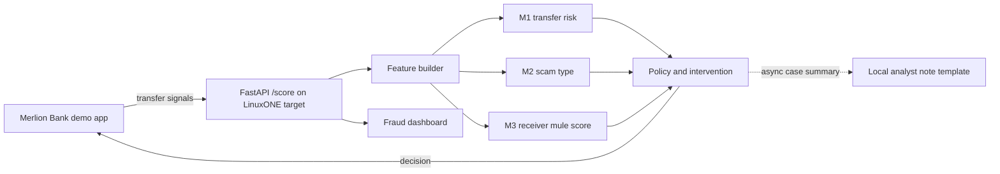

# SpellBreaker — [Team Name]_IBM Z Datathon 2026 Project

**SpellBreaker spots the moment a genuine customer is being manipulated into sending money, then interrupts with a scam-specific warning.** It asks: **“Is the owner under someone else’s control right now?”**

In 2025, Singapore recorded S$913.1 million in scam losses across 41,974 cases. 81.8% of cases involved self-effected transfers, where the real account owner sent the money. Seniors were about 15% of victims and had the highest average loss at S$37,053. [Singapore Police Force, 2025 annual scam figures](https://www.police.gov.sg/media-hub/police-life/2026/02/scams-and-cybercrime-fell-by-almost-a-quarter-in-2025)

The Protection from Scams Act allows police to direct banks to restrict an individual’s transfers for up to 30 days, with an extension possible. SpellBreaker is designed as an earlier intervention layer. [Ministry of Home Affairs](https://www.mha.gov.sg/media-room/newsroom/introduction-of-the-protection-from-scams-bill/)

<!-- RESULTS:START -->
Local synthetic PR-AUC: 0.873; legit interruption rate at T1: 1.35%.

Benchmark: 22.16473142559678 requests/s; server p50 347.7268749848008 ms, p95 356.29812499973923 ms. These figures are local and synthetic, not LinuxONE evidence.

See [full model results](docs/RESULTS.md).
<!-- RESULTS:END -->

## Demo

Screenshot/GIF placeholders: `docs/img/bank-demo.png`, `docs/img/dashboard.png`.

## IBM Z / LinuxONE evidence

| Claim | Evidence | Current status |
|---|---|---|
| Model trained on s390x | `evidence/train_l1cc.log`, bundle `trained_on` | Pending LinuxONE access |
| Served in a container on LinuxONE | `evidence/container.txt` | Pending LinuxONE access |
| Real-time latency and throughput | `results/bench.json` | Local result only after benchmark |
| Customer data stays within bank platform | `docs/PRIVACY.md` | Prototype design statement; no production deployment verified |
| Local GenAI | `/health` and `evidence/health.json` | Deterministic template fallback; no LLM runtime |
| Hyper Protect / Secure Execution; Telum NNPA via zDLC | — | **Production target, not used in this prototype** |

Multi-model hybrid: three predictive signals (transfer risk, scam typology, receiver mule score) plus one generative case-note component (currently a deterministic template). This prototype does not yet produce genuine MuleNet scores or use a generative model.

## Architecture



## Results

See [docs/RESULTS.md](docs/RESULTS.md) and the generated [model report](results/model_report.json). The reported data are synthetic. Do not interpret simulated losses prevented as real-world outcomes.

## Privacy and responsible AI

- Only a small set of transfer and yes/no interaction signals is sent to the scoring service.
- Caller number, audio, contacts, messages, clipboard contents, raw keystroke timings and location are not sent.
- All named customers and accounts are synthetic.
- A high score pauses or escalates a transfer for human review; the model does not automatically freeze an account.
- The age band is used only for reporting, never as a model feature. Review [docs/RESPONSIBLE_AI.md](docs/RESPONSIBLE_AI.md).

## Data

The victim-side data are generated by a typology simulator because banks cannot share real manipulated-customer cases. It reflects the four scam patterns in the specification and is explicitly synthetic. IBM AMLworld is the intended real receiver-side dataset; it is not included. The IBM AMLworld download instructions and licensing notes are in [docs/OPEN_SOURCE.md](docs/OPEN_SOURCE.md).

## Run locally

```bash
python3 -m venv .venv
. .venv/bin/activate
pip install -r requirements-dev.txt
python ml/spellbreaker_train.py --customers 5000 --loto
./scripts/run_local.sh
```

Then open `http://localhost:8000/bank/` or `http://localhost:8000/dashboard/`. For LinuxONE, run `./scripts/deploy_l1cc.sh`, then tunnel with `ssh -N -L 8000:localhost:8000 l1cc` and open the same URLs. Run acceptance checks with `pytest -q tests/`; benchmark with `python bench/loadtest.py --requests 10000 --concurrency 16`.

## Open source and data credits

See [docs/OPEN_SOURCE.md](docs/OPEN_SOURCE.md). Event code: **SSF2026**.
