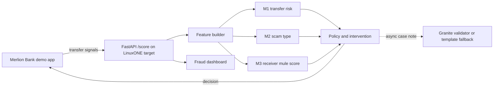

# SpellBreaker — tokenmaxxers | IBM Z Datathon 2026 Project

**SpellBreaker spots the moment a genuine customer is being manipulated into sending money, then interrupts with a scam-specific warning.** It asks: **“Is the owner under someone else’s control right now?”**

**Public repository:** [github.com/mvrkarthik07/spellbreaker-ibmz-datathon-2026](https://github.com/mvrkarthik07/spellbreaker-ibmz-datathon-2026)

In 2025, Singapore recorded S$913.1 million in scam losses across 41,974 cases. 81.8% of cases involved self-effected transfers, where the real account owner sent the money. Seniors were about 15% of victims and had the highest average loss at S$37,053. [Singapore Police Force, 2025 annual scam figures](https://www.police.gov.sg/media-hub/police-life/2026/02/scams-and-cybercrime-fell-by-almost-a-quarter-in-2025)

The Protection from Scams Act allows police to direct banks to restrict an individual’s transfers for up to 30 days, with an extension possible. SpellBreaker is designed as an earlier intervention layer. [Ministry of Home Affairs](https://www.mha.gov.sg/media-room/newsroom/introduction-of-the-protection-from-scams-bill/)

<!-- RESULTS:START -->
On the receiver-account holdout (0.40% mule base rate), XGBoost MuleNet achieves 7.46× lift and 7.46% recall at the top 1%, and 4.01× lift and 20.06% recall at the top 5%. SpellBreaker synthetic holdout PR-AUC is 0.8802, with a 1.13% legit interruption rate at T1.

Optimized local benchmark (10,000 requests, concurrency 16): server p50 7.53 ms and p99 27.37 ms ([raw JSON](results/bench_local.json)). LinuxONE after full-file XGBoost MuleNet retraining (10,000 requests, concurrency 16): server p50 23.68 ms and p99 26.40 ms ([raw JSON](results/bench.json)). The synthetic model metrics and measured service latency are separate from real-world effectiveness.

See [full model results](docs/RESULTS.md).
<!-- RESULTS:END -->

## Demo

Screenshot/GIF placeholders: `docs/img/bank-demo.png`, `docs/img/dashboard.png`.

## IBM Z / LinuxONE evidence

| Claim | Evidence | Current status |
|---|---|---|
| Model trained on s390x | [training log](evidence/train_l1cc.log), bundle `trained_on` | Verified; report says `trained_on=s390x` |
| Served in a container on LinuxONE | [container inspection](evidence/container.txt) | Verified; Ubuntu 24.04 container on l1cc |
| Real-time latency and throughput | [benchmark JSON](results/bench.json), [benchmark evidence](evidence/bench.txt) | Verified after full-file MuleNet retraining; LinuxONE server p99 26.40 ms |
| Customer data stays within bank platform | `docs/PRIVACY.md` | Prototype design statement; no production deployment verified |
| Local GenAI | `/health`, [50-case evaluation](results/genai_eval.json), [runtime evidence](evidence/genai_runtime.txt) | Granite acceptance was 0/50; deterministic template is default and Granite remains optional |
| Hyper Protect / Secure Execution; Telum NNPA via zDLC | — | **Production target, not used in this prototype** |

**AI stack:** scikit-learn (transfer-risk + scam-type models), XGBoost (receiver-mule model), and llama-cpp-python + IBM Granite (case notes, with deterministic validation and template fallback). MuleNet compares XGBoost with scikit-learn HistGradientBoosting on AMLworld; receiver-account metrics and exposure are in [the MuleNet report](results/mulenet_report.json). A small PyTorch MLP is evaluated as a notebook-only M1 challenger and is not served. See the [GenAI evaluation](results/genai_eval.json), [MuleNet run log](evidence/mulenet_l1cc.log), and [executed LinuxONE notebook](evidence/SpellBreaker_on_LinuxONE.executed.ipynb).

## Platform security on LinuxONE

- The scoring container runs as UID/GID `10001:10001`; Docker inspection recorded the configured user. It also runs with a read-only root filesystem, a size-bounded `/tmp` tmpfs, and all Linux capabilities dropped. See `evidence/container.txt`.
- LinuxONE exposes the CPACF message-security-assist (MSA) CPU facility. `evidence/cpu_features.txt` records the CPU flags and the literal `grep -c nnpa /proc/cpuinfo` result; `evidence/crypto.txt` records OpenSSL speed output and its OpenSSL runtime. Receiver-account sharing supports keyed HMAC-SHA256 tokens through Python `hmac`/`hashlib`; the evidence includes only a synthetic identifier and an ephemeral key is discarded.
- The local case-note adapter receives only the fixed allow-listed fact sheet (level, risk %, predicted scam type, exact reasons, amount band, and age band). Names, account numbers, and raw transaction identifiers are excluded; a deterministic validator rejects extra numbers, names, scam types, or missing lines. Accepted notes are marked as fact-checked; see `evidence/genai_prompt_sample.txt`, `evidence/genai_runtime.txt`, and `results/genai_eval.json`.
- NNPA is visible in CPU flags, but no model ran through zDLC in this prototype. Telum on-chip inference via zDLC is a production path, not a capability claimed as used here. Secure Execution / Hyper Protect is also a production target only.

## Team

- **Karthik Manda** — Model and deployment lead — SpellBreaker model integration, LinuxONE deployment, and demo.
- **Pranay Kanth Molugu** — Model and architecture lead — scam-risk modeling, system design, and demo development.
- **Sai Prakash Reddy** — Data and evaluation — AMLworld receiver-risk analysis and model evaluation.
- **Amrutha Vanaparthi** — Product and responsible AI — user journey, privacy, and responsible-use review.

## Judging rubric mapping

| Playbook tip / judging evidence | Evidence in this submission |
|---|---|
| Named AI frameworks and predictive + generative AI | This README's AI stack; [MuleNet report](results/mulenet_report.json) compares XGBoost and HistGradientBoosting; [executed notebook](evidence/SpellBreaker_on_LinuxONE.executed.ipynb) reports the PyTorch challenger; [runtime evidence](evidence/genai_runtime.txt) and [50-case evaluation](results/genai_eval.json) report Granite validation. Dashboard model/runtime indicators. |
| Run and train on LinuxONE | [platform evidence](evidence/platform.txt), [training log](evidence/train_l1cc.log), [live health snapshot](evidence/health.json), and [notebook source](notebooks/SpellBreaker_on_LinuxONE.ipynb) with its [executed copy](evidence/SpellBreaker_on_LinuxONE.executed.ipynb). |
| Containerisation and real-time performance | [container inspection](evidence/container.txt), [benchmark evidence](evidence/bench.txt), and [benchmark JSON](results/bench.json); LinuxONE service p99 is recorded in Results. |
| Demonstrated platform security | [container inspection](evidence/container.txt) (UID, read-only root, dropped capabilities), [crypto evidence](evidence/crypto.txt) and [CPU features](evidence/cpu_features.txt) (OpenSSL, MSA and NNPA visibility), and [privacy-safe prompt sample](evidence/genai_prompt_sample.txt) (allow-list). |
| Community value and responsible data use | [results](docs/RESULTS.md), [privacy](docs/PRIVACY.md), [responsible AI](docs/RESPONSIBLE_AI.md), and [open-source/data credits](docs/OPEN_SOURCE.md) (AMLworld source and CDLA-Sharing-1.0). |
| Team contribution and execution | This README's Team section and the 10-second Team & roles segment in `docs/VIDEO_SCRIPT.md`. |

## Architecture



## Results

See [docs/RESULTS.md](docs/RESULTS.md) and the generated [model report](results/model_report.json). The reported data are synthetic. Do not interpret simulated losses prevented as real-world outcomes.

## Privacy and responsible AI

- Only a small set of transfer and yes/no interaction signals is sent to the scoring service.
- Caller number, audio, contacts, messages, clipboard contents, raw keystroke timings and location are not sent.
- All named customers and accounts are synthetic.
- A high score pauses or escalates a transfer for human review; the model does not automatically freeze an account.
- The age band is used only for reporting, never as a model feature. Review [docs/RESPONSIBLE_AI.md](docs/RESPONSIBLE_AI.md).

## Data

The victim-side data are generated by a typology simulator because banks cannot share real manipulated-customer cases. It reflects the four scam patterns in the specification and is explicitly synthetic. IBM AMLworld HI-Small was supplied in `data/` on the laptop and LinuxONE; XGBoost MuleNet and the HistGradientBoosting comparison ran on all 5,078,345 rows on l1cc inside the official Jupyter image. The account-level receiver-score export and comparison report are in `results/`, and the Kaggle link and CDLA-Sharing-1.0 licence are in [docs/OPEN_SOURCE.md](docs/OPEN_SOURCE.md).

## Run locally

```bash
python3 -m venv .venv
. .venv/bin/activate
pip install -r requirements-dev.txt
python ml/spellbreaker_train.py --customers 5000 --loto
./scripts/run_local.sh
```

Then open `http://localhost:8000/bank/` or `http://localhost:8000/dashboard/`. For LinuxONE, run `./scripts/deploy_l1cc.sh`, then tunnel with `ssh -N -L 8000:localhost:8000 l1cc` and open the same URLs. Run acceptance checks with `pytest -q tests/`; benchmark with `python bench/loadtest.py --requests 10000 --concurrency 16`.

## Open source and data credits

See [docs/OPEN_SOURCE.md](docs/OPEN_SOURCE.md). Event code: **SSF2026**.
