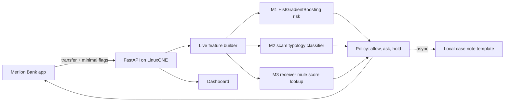

# Architecture

| Component | Responsibility |
|---|---|
| `ml/spellbreaker_train.py` | Synthetic manipulation typology training, time split, fairness and ablation reporting |
| `service/features.py` | Runtime transfer features and recent-history counts |
| M1 | Estimate manipulated transfer risk |
| M2 | Predict scam type for targeted interruption |
| M3 | Receiver account risk lookup (MuleNet scores from the supplied AMLworld subset) |
| `service/policy.py` | Map calibrated thresholds to intervention language and action |
| `service/genai.py` | Local deterministic analyst note fallback |
| Web apps | Synthetic bank transfer simulation and analyst dashboard |

The target hybrid comprises three predictive signals plus one generative component. This run includes MuleNet scores from AMLworld HI-Small. Case notes use the deterministic template because local Granite outputs failed factuality validation.
