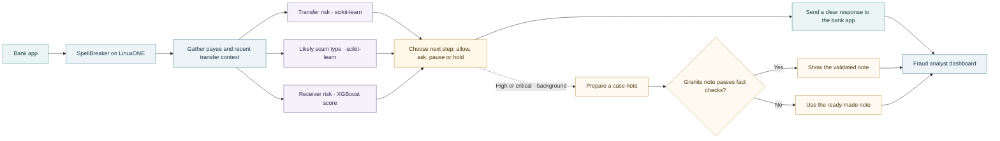

# How a transfer gets checked

The bank sends a transfer for a quick check. SpellBreaker looks at the context, weighs three risk signals, and sends a clear next step back to the app. Case notes happen in the background, so they do not slow down the score.

Case notes are only for high or critical decisions and use approved facts. Names, account numbers and raw transaction IDs are left out. Granite is optional; a note that fails validation falls back to the ready-made version.
